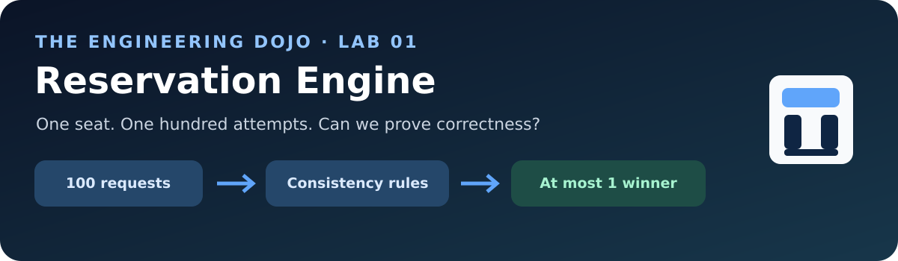
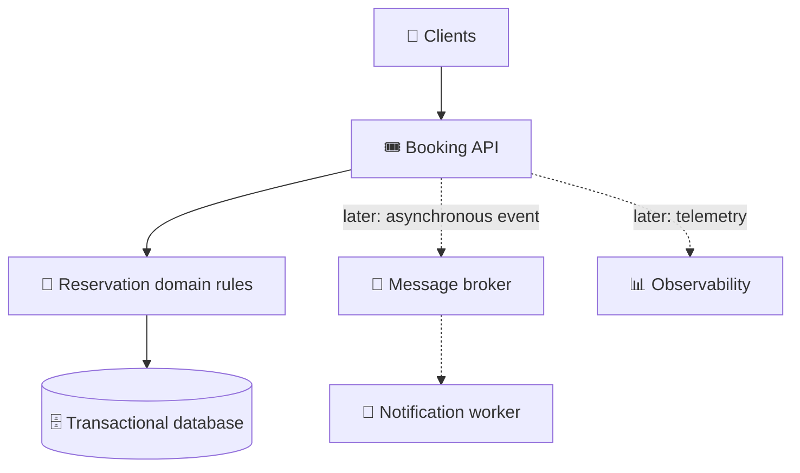

  

  # 🎟️ Reservation Engine

  **A hands-on software engineering lab for building correct, observable, and resilient systems.**

  [🥋 The Dojo](https://github.com/the-engineering-dojo) · [📚 Handbook](https://github.com/the-engineering-dojo/engineering-handbook) · [🗺️ Roadmap](docs/roadmap.md) · [🧪 Challenges](docs/challenges.md)

---

## 🎯 The first question

**100 people try to reserve the same seat at the same time. What guarantees that no two conflicting reservations become active?**

A booking flow looks simple until it meets concurrency, transaction boundaries, retries, duplicate messages, restarts, and multiple replicas.

This project is a deliberately small **case study**, designed to let a team reproduce those problems and compare solutions with evidence.

> 🚦 **Status: planning only.** No application or infrastructure implementation has been published yet. The roadmap, diagrams, and laboratory exercises describe work we intend to investigate—not features already shipped.

## 👀 The learning experience

| 🧠 Understand | 🧪 Prove | 🔀 Distribute | 🐳 Operate |
| --- | --- | --- | --- |
| Domain language, invariants, DDD | Transactions, races, tests | Messaging, idempotency, outbox | Docker, Kubernetes, observability |
| [Domain model →](docs/domain-model.md) | [Lab 01 →](labs/01-double-booking.md) | [Roadmap →](docs/roadmap.md) | [Cloud-native lab →](labs/05-kubernetes.md) |

## 🧩 Proposed system, not an implementation

The **starting architecture** is a modular monolith. We will introduce a separately deployable component only when a measurable learning question justifies it. [Read the proposed architecture →](docs/architecture.md)

## 🪜 Choose a lab

| Lab | Engineering question |
| --- | --- |
| [01 · Double booking](labs/01-double-booking.md) | Can we reproduce conflicting reservations? |
| [02 · Transactions](labs/02-transactions.md) | Which database mechanism protects the invariant? |
| [03 · Messaging](labs/03-messaging-outbox.md) | What happens if publishing fails after commit? |
| [04 · Docker](labs/04-docker.md) | Can the system run reproducibly across machines? |
| [05 · Kubernetes](labs/05-kubernetes.md) | What happens with multiple replicas and shared state? |
| [06 · Load testing](labs/06-load-testing.md) | How does latency and correctness change under load? |

[See every challenge and its acceptance evidence →](docs/challenges.md)

## 🗂️ Browse the project

- [🎬 Product brief & scenarios](docs/product-brief.md)
- [🧭 Roadmap and milestones](docs/roadmap.md)
- [🧩 Domain glossary & invariants](docs/domain-model.md)
- [🏗️ Architecture and trade-offs](docs/architecture.md)
- [🎨 Conceptual mockups](docs/mockups.md)
- [📜 Architecture decision records](docs/adr/0001-modular-monolith-first.md)
- [🤝 How to work together](CONTRIBUTING.md)

## 🙌 Contribute as a human

Open a question, sketch an alternative, challenge a hypothesis, or write a lab debrief. We value reproducible experiments and careful reviews, **not AI-generated volume**.

**No code yet:** the team is organizing learning goals and discussing architecture before implementation. [Team contribution guide →](CONTRIBUTING.md)