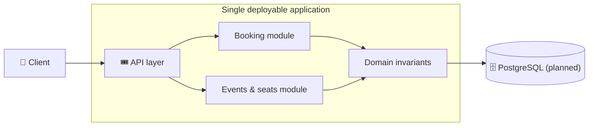
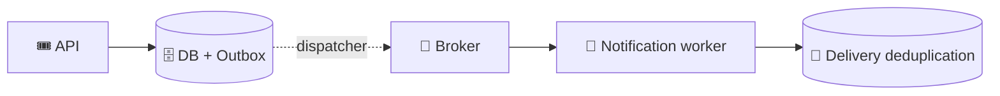
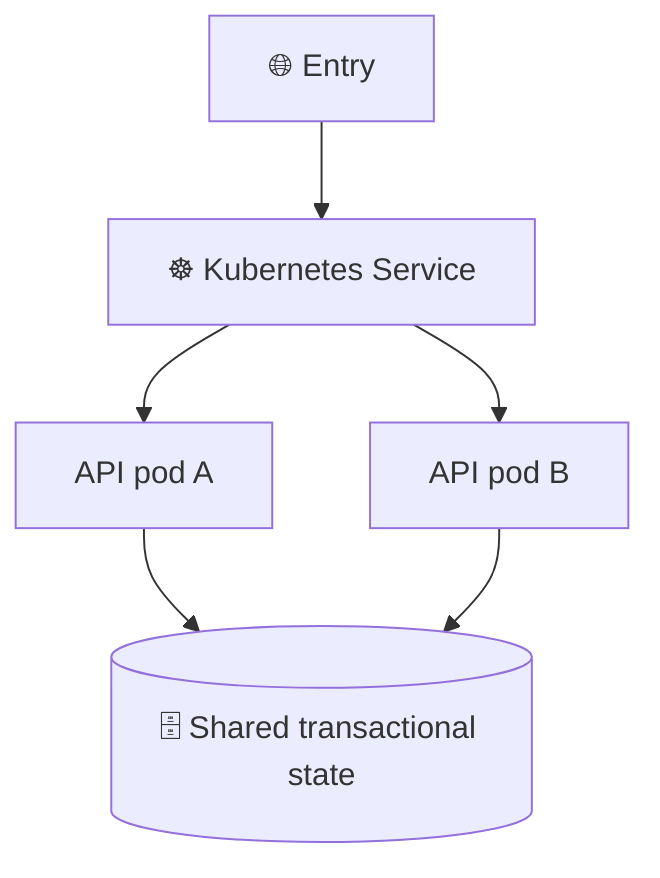

# 🏗️ Architecture — progressive complexity

[← Project](../README.md) · [🗺️ Roadmap](roadmap.md) · [📜 ADR 0001](adr/0001-modular-monolith-first.md)

The first architectural choice is deliberate: **start as a modular monolith**, then learn what distribution changes.

## Stage A — Single process, explicit boundaries

**Study:** domain rules, aggregate boundaries, database transactions, concurrency, unit/integration testing.

## Stage B — Introduce an asynchronous boundary

**Study:** at-least-once delivery, retries, idempotent effects, delayed updates, and how failures are recovered.

## Stage C — Multiple replicas

**Study:** containerization, rollout behavior, configuration, probes, state boundaries, and telemetry.

## 🛑 Intentional anti-patterns to avoid

- Splitting every domain noun into a separate service.
- Sharing mutable in-memory state as the sole source of truth.
- Distributed transactions when a simpler local boundary is sufficient.
- Calling a retry mechanism “exactly once” without stating what effect is protected.
- Introducing Kubernetes before understanding deployment/runtime requirements.

### 🔍 Why not begin with microservices?

Because a local transactional case makes the concurrency invariant easier to understand and measure. A network boundary adds failures; it does not automatically solve existing correctness problems. See [the decision record](adr/0001-modular-monolith-first.md).