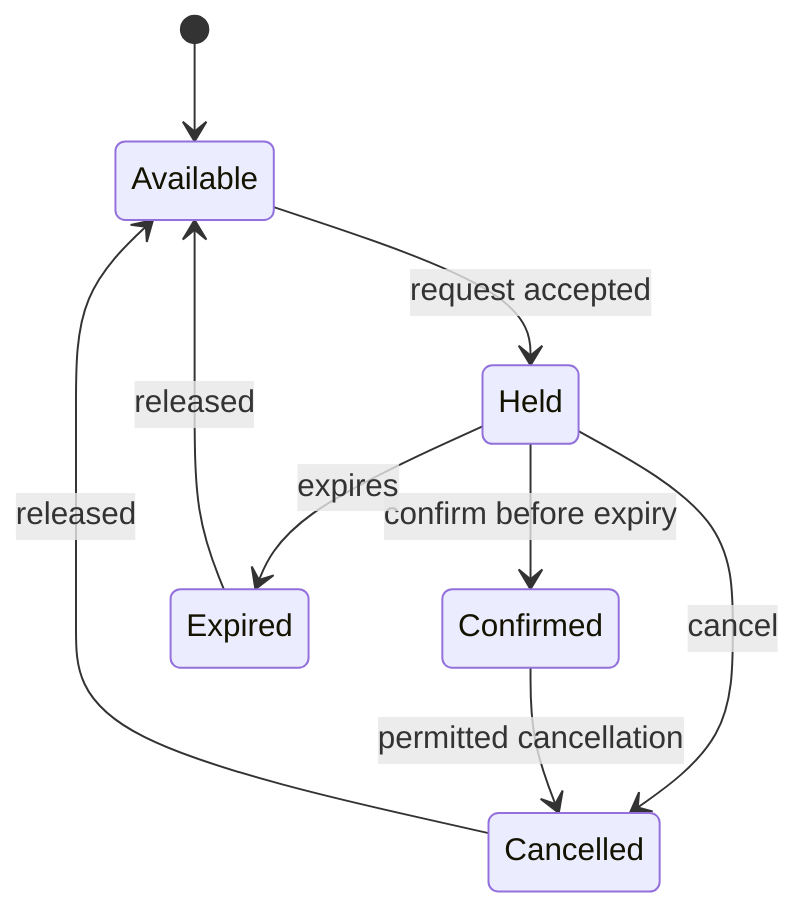

# 🧩 Domain vocabulary and invariants

[← Project](../README.md) · [🧠 DDD notes](https://github.com/the-engineering-dojo/engineering-handbook/blob/main/notes/ddd-and-boundaries.md)

These are **proposed modeling assumptions** to debate before implementation.

## 📘 Language

| Term | Proposed meaning |
| --- | --- |
| Event | A scheduled occasion with reservable seats |
| Seat | A uniquely identified capacity unit belonging to an event |
| Hold | A temporary exclusive claim that has an expiration |
| Reservation | The lifecycle of a claim on a seat |
| Confirmation | Transition from valid hold to committed booking |
| Cancellation | Transition that releases an occupied claim |
| Idempotency key | Client-supplied operation identity for safe retries |

## 🔒 Invariants to investigate

1. **Exclusivity:** for one event/seat, no two conflicting active holds or confirmed bookings coexist.
2. **Valid transitions:** expired or cancelled claims cannot be confirmed without re-validation.
3. **Retry safety:** the same request identity does not create multiple claims.
4. **Durability:** a successful confirmed booking must survive a process restart.
5. **Ownership:** a defined transactional boundary enforces availability; in-memory local locks cannot be the only defense.

**Important:** “At most one” and “Exactly one” are different claims. If all attempts fail, the exclusivity invariant still holds; successful allocation is a separate liveness requirement.

## 🗣️ Unanswered questions

- Can one user hold several seats in one operation?
- Is hold expiration evaluated by wall clock, database time, or a background job?
- Should confirmation require payment simulation or simply a state transition?
- Is a separate Inventory aggregate actually justified?

Discuss answers before coding. Capture changes in an ADR.

## 📐 Conceptual lifecycle

This chart describes the conceptual seat/claim states, **not a finalized database state machine**.