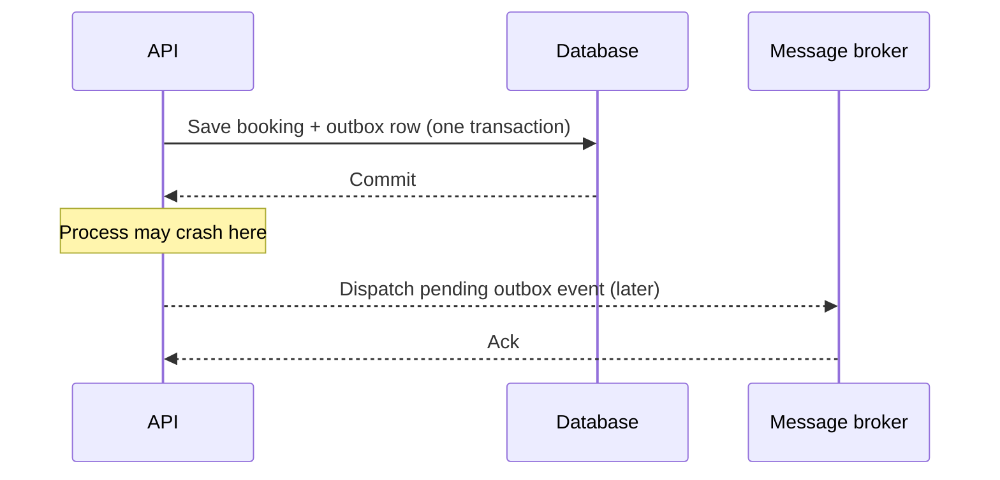

# 🟠 Lab 03 — Messaging, Outbox and Inbox

[← Labs](README.md) · [📨 Distributed path](https://github.com/the-engineering-dojo/engineering-handbook/blob/main/learning-paths/03-distributed-systems.md)

### 🎯 Question

A booking is committed, then the process crashes before publishing its event. How do we recover without losing or duplicating the business effect?

### 🎬 Failure timeline

### 🧪 Proposed experiments

1. Compare **direct publish after commit** with a **transactional outbox**.
2. Simulate a crash after DB commit but before broker confirmation.
3. Repeat the same event twice and reason about consumer idempotency.
4. Define how retries, poison messages, and dead-letter recovery should work.
5. Identify which effects are eventually consistent.

### ✅ Evidence

State-transition table, failure/recovery timeline, and a clear distinction between at-least-once message delivery and exactly-once **business effects**.

### 🪜 Stretch

What changes if notifications are sent to a third-party provider with no transactional guarantees?

**Status: design exercise; no broker or worker is deployed.**